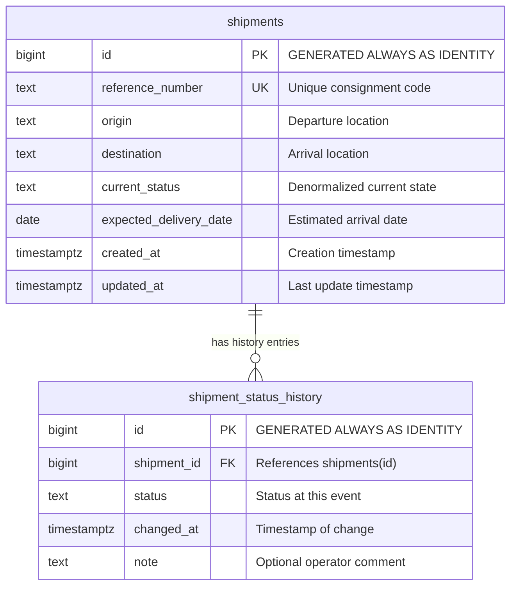

# Data Model & Persistence Specification

## 1. Overview & Conceptual Model

The persistence design is built on a clean, normalized relational model with two core entities:
1. **`shipments`**: The parent record holding current shipment attributes and the denormalized `current_status` for fast list/filter operations.
2. **`shipment_status_history`**: The child audit trail recording every status change, timestamp, and optional remarks over the shipment's lifecycle.



---

## 2. Table Schemas & Constraints (Migration 001)

*(The migration SQL is authored at [`backend/migrations/001_initial_schema.sql`](../backend/migrations/001_initial_schema.sql). To apply to Supabase, copy its content into the Supabase Dashboard SQL Editor or execute via connected tooling once approved).*

### Applying the Migration via Supabase SQL Editor
1. Log into your Supabase Dashboard and select project `aryan-oo9's Project` (`ykajnrhhatfvuyckzoqr`).
2. Navigate to **SQL Editor** in the left sidebar.
3. Open or paste the contents of [`backend/migrations/001_initial_schema.sql`](../backend/migrations/001_initial_schema.sql).
4. Click **Run** to create `shipments`, `shipment_status_history`, constraints, and indexes.
5. Verify table creation in the **Table Editor**.

### Table 1: `shipments`

| Column | Data Type | Nullable | Constraints & Defaults | Description |
|---|---|---|---|---|
| `id` | `BIGINT` | `NOT NULL` | `PRIMARY KEY GENERATED ALWAYS AS IDENTITY` | Unique sequential identifier. |
| `reference_number` | `VARCHAR(64)` | `NOT NULL` | `UNIQUE` | Unique tracking code (e.g. `NF-100234`). Indexed. |
| `origin` | `VARCHAR(255)` | `NOT NULL` | None | Origin city/country or warehouse terminal. |
| `destination` | `VARCHAR(255)` | `NOT NULL` | None | Destination city/country or delivery point. |
| `current_status` | `VARCHAR(32)` | `NOT NULL` | `CHECK (current_status IN ('Booked', 'In Transit', 'Customs Hold', 'Delivered'))` | Fast access to current status. |
| `expected_delivery_date`| `DATE` | `NOT NULL` | None | Target delivery date. |
| `created_at` | `TIMESTAMPTZ` | `NOT NULL` | `DEFAULT CURRENT_TIMESTAMP` | Consignment creation timestamp with UTC timezone. |
| `updated_at` | `TIMESTAMPTZ` | `NOT NULL` | `DEFAULT CURRENT_TIMESTAMP` | Last updated timestamp with UTC timezone. |

### Table 2: `shipment_status_history`

| Column | Data Type | Nullable | Constraints & Defaults | Description |
|---|---|---|---|---|
| `id` | `BIGINT` | `NOT NULL` | `PRIMARY KEY GENERATED ALWAYS AS IDENTITY` | Audit record primary key. |
| `shipment_id` | `BIGINT` | `NOT NULL` | `REFERENCES shipments(id) ON DELETE RESTRICT` | Foreign key referencing parent shipment. |
| `status` | `VARCHAR(32)` | `NOT NULL` | `CHECK (status IN ('Booked', 'In Transit', 'Customs Hold', 'Delivered'))` | Status recorded at this event. |
| `changed_at` | `TIMESTAMPTZ` | `NOT NULL` | `DEFAULT CURRENT_TIMESTAMP` | Event timestamp with UTC timezone. |
| `note` | `TEXT` | `NULL` | None | Optional operational remark or explanation. |

---

## 3. Status Transition Rules & Assumptions

1. **Initial Allowed Status Values:**
   - `Booked`
   - `In Transit`
   - `Customs Hold`
   - `Delivered`
2. **State Machine Flexibility:**
   - These 4 statuses constitute the valid universe of statuses for this assignment.
   - They do **not** represent a strict one-way state machine in this version. For example, a shipment in `In Transit` may move to `Customs Hold`, and then return to `In Transit`. Any valid status may be chosen by the operator as logistics situations dictate.
3. **Immutable History:**
   - The `shipment_status_history` table is strictly **append-only** during all normal application operations. Rows in this table are never updated or mutated.

---

## 4. Transactional Integrity & Concurrency

To ensure complete data consistency between the denormalized `current_status` on the parent table and the historical records:

### Atomic Shipment Creation
```sql
BEGIN;
  -- 1. Insert new shipment
  INSERT INTO shipments (reference_number, origin, destination, current_status, expected_delivery_date)
  VALUES ($1, $2, $3, $4, $5)
  RETURNING id;

  -- 2. Insert initial status history record using the returned shipment id
  INSERT INTO shipment_status_history (shipment_id, status, note)
  VALUES ($id, $4, 'Shipment booked and registered');
COMMIT;
```
If either query fails (e.g., duplicate `reference_number`), the entire transaction rolls back (`ROLLBACK`), preventing orphan shipment or history records.

### Atomic Status Update
```sql
BEGIN;
  -- 1. Update current_status and updated_at on parent record
  UPDATE shipments
  SET current_status = $new_status, updated_at = CURRENT_TIMESTAMP
  WHERE id = $id;

  -- 2. Append new audit entry
  INSERT INTO shipment_status_history (shipment_id, status, note)
  VALUES ($id, $new_status, $note);
COMMIT;
```
Both queries execute within the same transaction. If an error occurs, the rollback ensures the parent status and history trail never diverge.

---

## 5. Indexing Strategy & Query Performance

To support 10,000+ shipments with rapid query response times:

1. **`idx_shipments_reference_number`**:
   - Unique B-Tree index on `shipments(reference_number)` (automatically created by `UNIQUE` constraint). Guarantees O(log N) lookup when searching by tracking number.
2. **`idx_shipments_current_status`**:
   - B-Tree index on `shipments(current_status)` to accelerate filtering the dashboard list by status.
3. **`idx_history_shipment_id`**:
   - B-Tree index on `shipment_status_history(shipment_id)` to ensure instant retrieval of a shipment's full audit trail.
4. **Deterministic History Ordering:**
   - All history queries must explicitly specify `ORDER BY changed_at ASC, id ASC` so sequential audit display is deterministic even if two events happen within the same microsecond.

---

## 6. Referential Integrity & Deletion Behavior

- Foreign key constraint is defined with `ON DELETE RESTRICT`.
- In a freight forwarding audit system, deleting active or historical consignments without trace violates cargo compliance. Restrictive deletion prevents accidental cascades that would purge audit logs.
- Hard deletions are out of scope for the required assignment features.
